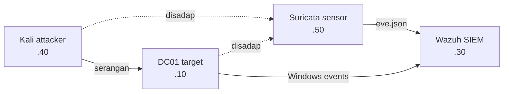

# Network IDS Layer dengan Suricata & Wazuh

Proyek ini menambahkan deteksi berbasis jaringan ke home SOC lab saya.
Sebelumnya lab sudah punya deteksi host-based (Wazuh + Sysmon di Active
Directory), tapi ada satu titik buta: serangan yang terlihat jelas di
jaringan belum tentu tertangkap dari sisi host. Jadi saya bangun sensor
Suricata untuk menutup celah itu, lalu menyambungkannya ke Wazuh supaya
alert network dan host berada di satu tempat.

Yang saya kerjakan di sini bukan sekadar memasang Suricata, tapi
menemukan celah deteksinya, menulis rule sendiri untuk menutupnya, dan
mencoba mengorelasikan serangan jaringan dengan serangan host.

Ini kelanjutan dari dua proyek lab sebelumnya:
[deteksi serangan Active Directory](https://github.com/Pratamaudin/wazuh-ad-threat-detection)
dan [CIS hardening dengan Wazuh SCA](https://github.com/Pratamaudin/cis-hardening-wazuh-sca).

## Arsitektur

Semua VM ada di jaringan VirtualBox host-only `192.168.56.0/24`. Sensor
Suricata saya pasang di VM terpisah dan dijalankan dalam promiscuous mode,
sehingga bisa "mendengar" trafik antara Kali dan DC01 meski bukan tujuannya.



- **Kali** (`.40`) — attacker
- **DC01** (`.10`) — domain controller, target
- **Sensor Suricata** (`.50`) — network IDS
- **Wazuh** (`.30`) — SIEM

## Celah deteksi yang saya temukan

Saya mulai dari recon. Dengan nmap, DC01 terpetakan sepenuhnya — bahkan
`nmap -sV` sampai mengenali domain-nya sebagai Active Directory lengkap
dengan port Kerberos (88), LDAP (389), dan SMB (445):

```
88/tcp   open  kerberos-sec
389/tcp  open  ldap
445/tcp  open  microsoft-ds
636/tcp  open  ldapssl
```

Masalahnya, ET Open ruleset bawaan Suricata sama sekali tidak mengeluarkan
alert scan untuk ini. SYN scan nmap terlalu senyap untuk ditangkap
signature bawaan. Padahal kalau dicek dengan tcpdump, paket SYN-nya jelas
sampai ke sensor:

```
192.168.56.40.36619 > 192.168.56.10.445: Flags [S]
192.168.56.40.36619 > 192.168.56.10.88:  Flags [S]
...
```

Jadi sensornya sehat, paketnya sampai, tapi tidak ada yang mendeteksi.
Celah ini yang kemudian saya tutup dengan rule sendiri — polanya mirip
dengan gap host-based yang saya temukan di lab sebelumnya.

## Menutup celah dengan rule sendiri

Deteksinya saya buat dua lapis.

**Di Suricata**, saya tulis rule yang menyala kalau satu sumber mengirim
banyak paket SYN ke banyak port dalam waktu singkat — pola khas port scan:

```
alert ip 192.168.56.40 any -> 192.168.56.10 any (msg:"CUSTOM SCAN dari Kali ke DC01"; threshold:type threshold, track by_src, count 20, seconds 10; classtype:attempted-recon; sid:1000001; rev:7;)
```

**Di Wazuh**, alert Suricata masuk lewat rule bawaan di level 3 (cuma
informational). Saya buat rule yang mengangkatnya ke level 12 dan menandai
dengan MITRE T1046 (Network Service Discovery), plus menampilkan IP
penyerang dan targetnya langsung di deskripsi:

```xml
<rule id="100400" level="12">
  <if_sid>86601</if_sid>
  <field name="alert.signature">CUSTOM SCAN</field>
  <description>Suricata: Port scan terdeteksi dari $(src_ip) ke $(dest_ip)</description>
  <mitre><id>T1046</id></mitre>
</rule>
```

Hasilnya, dari yang tadinya tidak terdeteksi sama sekali, scan dari Kali
sekarang muncul di dashboard sebagai alert level 12 — hampir seratus alert
dalam satu kali pengujian, lengkap dengan IP dan tag MITRE-nya.

## Korelasi network dengan host (masih dikerjakan)

Bagian yang paling ingin saya capai adalah menyatukan alert network dan
host jadi satu insiden. Idenya: kalau satu IP melakukan port scan (terlihat
di Suricata) lalu disusul serangan ke host seperti password spraying
(terlihat di Wazuh) dalam waktu berdekatan, Wazuh menyalakan satu alert
"multi-stage attack" yang merangkum keduanya.

Rule-nya (`100500`) sudah saya tulis dan lolos validasi, tapi belum
berhasil menyala end-to-end. Setelah ditelusuri, hambatannya ada di field
IP yang berbeda antara dua sumber: alert network menyimpan IP di `srcip`,
sementara alert host menyimpannya di `win.eventdata.ipAddress`. Karena
field-nya beda, helper korelasi bawaan tidak bisa mencocokkan IP keduanya.

Saya catat analisis lengkap dan rencana perbaikannya di
[`docs/correlation-notes.md`](docs/correlation-notes.md). Sengaja saya tulis
apa adanya — proses mencari tahu kenapa belum jalan ini bagian dari
pekerjaan detection engineering itu sendiri.

## Beberapa hal yang sempat menyusahkan

Ada tiga masalah yang cukup memakan waktu, tapi justru paling banyak
mengajari saya:

**Service aktif tapi tidak menangkap apa-apa.** Suricata yang dijalankan
manual sebagai root bisa menangkap scan, tapi lewat systemd service hasilnya
nol alert. Ternyata sandboxing systemd (`ProtectSystem=full`,
`ProtectHome=true`) yang memblokir akses capture. Perbaikannya ada di
[`suricata-rules/suricata.service`](suricata-rules/suricata.service).

**Nama field yang menipu.** Di Wazuh, field signature Suricata diakses
sebagai `alert.signature`, bukan `data.alert.signature`. Prefix `data.` cuma
muncul di tampilan dashboard, bukan saat rule matching. Ini bikin beberapa
percobaan rule saya gagal sebelum ketemu penyebabnya.

**Threshold vs detection_filter.** nmap mengirim satu SYN per port ke port
yang berbeda-beda, jadi tiap paket dihitung sebagai flow tersendiri.
`detection_filter` yang menghitung per-flow tidak pernah menumpuk sampai
ambang. Harus pakai `threshold:type threshold, track by_src` yang menghitung
per-IP sumber lintas flow.

Satu pelajaran kecil tapi berguna: jangan percaya `tail -f | grep` untuk
verifikasi — buffering bisa menipu. Lebih aman baca langsung dari file log.

## Isi repo

```
suricata-rules/
  local.rules              custom rule port scan
  suricata.yaml.snippet    konfigurasi HOME_NET, interface, rule-files
  suricata.service         systemd unit yang berhasil capture
wazuh-rules/
  local_rules.xml          rule 100400 (+ 100500 korelasi)
  agent-ossec.conf.snippet forward eve.json ke Wazuh
docs/
  setup.md                 langkah membangun ulang
  correlation-notes.md     analisis rule korelasi
```

Langkah membangun ulang dari awal ada di [`docs/setup.md`](docs/setup.md).

---

Semua pengujian dilakukan di lingkungan lab terisolasi milik sendiri,
sebagai latihan untuk peran SOC Analyst.
